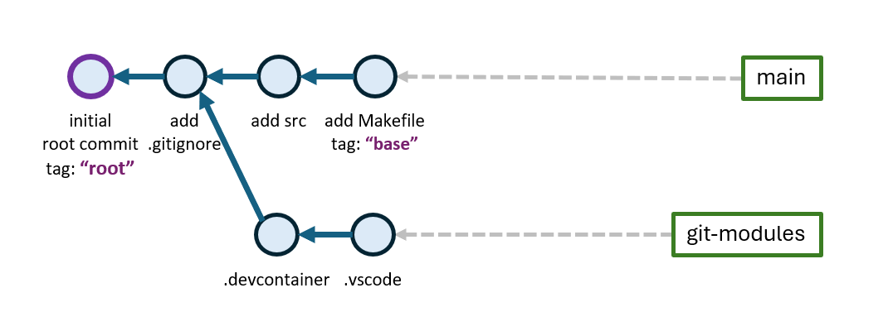

<!-- - - - - - - - - - - - - - - - - - - - - - - - - - - - - - - - - - - - -->
<!-- Solution of Assignment A2 (CS4BD)
-->
## Assignment B: Structured *Python*-Project


<!-- - - - - - - - - - - - - - - - - - - - - - - - - - - - - - - - - - - - -->
The assignment shows practices how to create a structured *Python* project.
Few rules should generally be followed, regardless of the programming language:

- *Source code* resides in the `src` directory in the project directory.

- *Test code* (e.g. unit tests) is always separated from the source code and
    resides in a `tests` directory.

- Each, `src` and `tests`, have sub-directories to further structure the code.
    The structure under `tests` should mirror the structure under `src`.

- Source code (only) is put under code management (e.g. *git*), no build
    artifacts, tools, generated documentation or binaries.

- The *build-process* defines the steps a project requires *"to be built"*.
    The build process should be automated by a *build tool* and correctly
    work at any time.

*Python* does not assume or enforce (unlike *Java/maven*) any structure of a
software development project.

Read article by *Ken Reitz:*
[*"Structuring Your Project"*](https://docs.python-guide.org/writing/structure)
and learn about *best-practices* that should be followed in *Python*
(obviously, the particularities can be debated, but introducing structure
into processes and into a project is a sign of good software engineering).

---

In this assignment, we set-up a new *Python* project following the guidance
from the article.
The project will create two *"components"*, a *"Calculator"* component
with methods:

- *add(a, b)* - return the sum of *a* and *b*, 

- *sub(a, b)* - subtract *b* from *a*,

- *mul(a, b)* - multiply *a* and *b*,

- *div(a, b)* - divide *a* by *b*,

- *factorize( n )* - return prime factors of *n*.

*"Calculator"* is a singleton component.


Component *"Collection"* provides *list* and *set* methods:

- *contains( s, e )* - calculate the number of times element *e* is in *s*,

- *zip(s, p)* - pair consequitive elements from *s* and *p*,

- *pset( s )* - calculate the powerset of *s*,

- *perm( p )* - calculate permutations of *p*,

*"Collection"* is an instantiatable component.


---
Steps:

1. Step: [*Answer Questions for Python Project-Setup*](#1-answer-questions-for-python-project-setup).

1. Step: [*Create project: "py-fun"*](#2-create-project-py-fun).

1. Step: [*Import *Git-Submodules*](#3-import-git-submodules).

1. Step: [*Build the Project*](#4-build-the-project).

1. Step: [*Create the Calculator*](#5-create-the-calculator).

1. Step: [*Run the Calculator*](#6-run-the-calculator).

1. Step: [*Extend the Calculator*](#7-extend-the-calculator).

1. Step: [*Check Project into Local git Repository*](#8-check-project-into-local-git-repository).

1. Step: [*Push Project to Remote *git* Repository*](#9-push-project-to-remote-git-repository).
<!-- 
1. Step: [*Unit Tests*](#9-unit-tests).

1. Step: [*Release*](#10-release).
    - build distributable package, actually release 'make build'
-->


<!-- - - - - - - - - - - - - - - - - - - - - - - - - - - - - - - - - - - - -->

&nbsp;
---
### 1. Answer Questions for *Python* Project-Setup

1. What is the *project scaffold*?

1. What is a software *build process*?

1. When does the software *build process* start and when does it end?

1. What are steps and what is the result of the software *build process*?

1. What is *make*?

1. What is the purpose of file *requirements.txt*? How is it used?

1. What is a *Build Server*? What does it mean for *Python*?

1. What are *Nightly Builds*?

1. What are the differences between
    [*"Scripts, Modules, Packages, and Libraries"*](https://realpython.com/videos/scripts-modules-packages-and-libraries)
    in *Python*?

1. What is *_ _ _init_ _ _.py* used for?


<!-- - - - - - - - - - - - - - - - - - - - - - - - - - - - - - - - - - - - -->

&nbsp;
---
### 2. Create Project: "py-fun"

Find a proper workspace (directory) on your laptop to host the new project:

```sh
# cd to the directory where you store your Python projects
cd <path-to-workspace>

mkdir py-fun                    # create the new project 'py-fun'

cd py-fun                       # cd into the new project

mkdir -p src/calculator         # make the directory for the 'Calculator'
mkdir -p tests/calculator       # make directory for 'Calculator' tests

# fetch files from the repository
url="https://raw.githubusercontent.com/sgra64/py-fun/refs/heads/main"
curl -o makefile $url/makefile          # fetch 'makefile' from URL
curl -o requirements.txt $url/requirements.txt

# fetch more files from the repository
files=(makefile requirements.txt
    setup.py
    main.py
    src/main.py
    src/__init__.py
    src/import_module.py
    src/calculator/__init__.py
    src/calculator/main.py
    src/calculator/calculator.py
)
for file in ${files[@]}; do
    echo -e "\n  --> " $file
    curl -o $file $url/$file
done

find .                          # show project scaffold
```

Output shows the files of the project:

```
main.py
makefile
requirements.txt
setup.py
src
src/calculator
src/calculator/calculator.py
src/calculator/main.py
src/calculator/__init__.py
src/import_module.py
src/main.py
src/__init__.py
tests
tests/calculator
```

The diagram shows the project structure (scaffold):

```sh
<workspace>             # workspace with Python projects
 |
 +-<py-fun>                 # project directory
 |  +--makefile                 # project build file
 |  +--requirements.txt         # installation dependencies
 |  |
 |  +--main.py                  # main driver, launches 'src/main.py'
 |  +-<src>                     # project source code
 |  |  +--__init.py__           # package file
 |  |  +--import_module.py      # programmatic module import
 |  |  +--main.py               # main driver that runs code
 |  |  |
 |  |  +-<calculator>           # package 'calculator'
 |  |  |  +--__init.py__        # package is collection of modules
 |  |  |  +--calculator.py      # module calculator (class)
 |  |  |  +--main.py            # package driver
 |  |
 |  +-<tests>                   # project test code
 |     +-<calculator>           # sub-directory for 'Calculator' test code
```


<!-- - - - - - - - - - - - - - - - - - - - - - - - - - - - - - - - - - - - -->

&nbsp;
---
### 3. Import *Git-Submodules*

[*Git Submodules*](https://git-scm.com/book/en/v2/Git-Tools-Submodules)
(read the: [*article*](https://www.freecodecamp.org/news/how-to-use-git-submodules/))
can be used to include content into a *git*-project that is not part of its
actual source code and maintained separately in the team.

This is often the case for IDE settings files or for *dev-containers*.
We want to include two *git-submodules* into the project:

- directory `.vscode` for *VSCode* settings files maintained in a separate
    *git*-repository:
    [*https://github.com/sgra64/gitmodule-vscode-py*](https://github.com/sgra64/gitmodule-vscode-py)
    and

- directory `.devcontainer` for the *devcontainer* settings of the project
    maintained in another *git*-repository:
    [*https://github.com/sgra64/dev-container-python*](https://github.com/sgra64/dev-container-python).

In order to separate *git-submodules* from the rest of the project, they are
maintained on a separate branch: *"git-modules"*.

Steps:

1. Initialize the project with a *git*-repository.

1. Create an empty root commit with commit message: `"root commit (empty)"`.
    Tag the commit with *"root"*.

1. Create a file [*.gitignore*](https://github.com/sgra64/py-fun/blob/main/.gitignore)
    and fill in content from the link. Commit the file with commit message: `"add .gitignore"`.
    <!-- curl -o .gitignore $url/.gitignore -->

1. Commit file *main.py* and folder *src* with the commit message:
    `"add src"`.

1. Commit files *makefile* and *requirements.txt* with the commit message:
    `"add makefile, requirements.txt"` and tag as *"base"*.

    Show the commit log:

    ```sh
    # show the commit log
    git log --oneline
    ```
    ```
    a5f5bc1 (HEAD -> main, tag: base) add makefile, requirements.txt
    e0074bc add src
    95dd980 add .gitignore
    3dffdb7 (tag: root) root commit (empty)
    ```

1. All commits have been recorded on branch *main*. *Git Submodules* will be
    recorded on a separate branch *"git-modules"* branched-off the *main* branch
    at the second commit (*"add .gitignore"*):

    ```sh
    # create new branch 'git-modules' branched off at the second commit
    git switch -c git-modules HEAD~2

    # show branches
    git branch

    # show the commit log
    git log --oneline
    ```
    ```
    * git-modules 95dd980 add .gitignore
    main        a5f5bc1 add makefile, requirements.txt

    95dd980 (HEAD -> git-modules) add .gitignore
    3dffdb7 (tag: root) root commit (empty)
    ```

    Branch *git-modules* now shows as active branch (with `*`). The commit log
    shows two commits of the *main* branch where the new branch is based on.

1. Import the first *git-module* `.vscode`:

    ```sh
    # import git submodule '.vscode' from the remote repository
    git submodule add -f -- https://github.com/sgra64/gitmodule-vscode-py .vscode

    # show new module in project
    ls -la
    ```
    ```
    total 18
    drwxr-xr-x 1   0 Oct 25 21:02 ./
    drwxr-xr-x 1   0 Oct 25 19:48 ../
    drwxr-xr-x 1   0 Oct 25 21:02 .git/
    -rw-r--r-- 1 408 Oct 25 20:42 .gitignore
    -rw-r--r-- 1  91 Oct 25 21:02 .gitmodules   <-- new file
    drwxr-xr-x 1   0 Oct 25 21:02 .vscode/      <-- new git-module
    drwxr-xr-x 1   0 Oct 25 20:49 src/
    drwxr-xr-x 1   0 Oct 25 19:49 tests/
    ```

    Remove file *.gitmodules* from the index and commit the new module:

    ```sh
    # remove .gitmodules file from the tracking index to avoid removal when switching branches
    git rm --cached .gitmodules

    # commit the new module '.vscode'
    git commit -m "add git-submodule: .vscode"

    # show the commit log
    git log --oneline
    ```
    ```
    ed2886b (HEAD -> git-modules) add git-submodule: .vscode
    95dd980 add .gitignore
    3dffdb7 (tag: root) root commit (empty)
    ```

1. Import the second *git-module* `.devcontainer`:

    ```sh
    # import git submodule '.vscode' from the remote repository
    git submodule add -f -- https://github.com/sgra64/dev-container-python .devcontainer

    # remove .gitmodules file from the tracking index to avoid removal when switching branches
    git rm --cached .gitmodules

    # commit the new module '.vscode'
    git commit -m "add git-submodule: .devcontainer"

    # show the commit log
    git log --oneline
    ```
    ```
    564a77d (HEAD -> git-modules) add git-submodule: .devcontainer
    ed2886b add git-submodule: .vscode
    95dd980 add .gitignore
    3dffdb7 (tag: root) root commit (empty)
    ```

Switch back to the *main* branch:

```sh
# switch back to the 'main' branch
git switch main
```

Ignore the warning:

```
warning: unable to rmdir '.devcontainer': Directory not empty
warning: unable to rmdir '.vscode': Directory not empty
Switched to branch 'main'
```

The project has now  installed the two *git-submodules*.

```sh
# show project content
ls -la
```
```
total 31
drwxr-xr-x 1 svgr2 Kein    0 Oct 25 21:14 .
drwxr-xr-x 1 svgr2 Kein    0 Oct 25 19:48 ..
drwxr-xr-x 1 svgr2 Kein    0 Oct 25 21:12 .devcontainer     <-- new git-module
drwxr-xr-x 1 svgr2 Kein    0 Oct 25 21:15 .git
-rw-r--r-- 1 svgr2 Kein  408 Oct 25 20:42 .gitignore
-rw-r--r-- 1 svgr2 Kein  195 Oct 25 21:12 .gitmodules       <-- gitmodules file
drwxr-xr-x 1 svgr2 Kein    0 Oct 25 21:02 .vscode           <-- new git-module
-rw-r--r-- 1 svgr2 Kein   60 Oct 25 21:14 main.py
-rw-r--r-- 1 svgr2 Kein 1168 Oct 25 21:14 makefile
-rw-r--r-- 1 svgr2 Kein 1079 Oct 25 21:14 requirements.txt
drwxr-xr-x 1 svgr2 Kein    0 Oct 25 21:14 src
drwxr-xr-x 1 svgr2 Kein    0 Oct 25 19:49 tests
```

The project now has the following *branch*-structure:



*Git-submodules* can be validated for updates that may have been issued:

```sh
# switch to the 'git-modules' branch
git switch git-modules

# check for updates and install, if any
git submodule foreach git pull
```
```
Entering '.devcontainer'
Already up to date.
Entering '.vscode'
Already up to date.
```

Switch back to the *main* branch:

```sh
# switch back to the 'main' branch
git switch main
```


&nbsp;

Launch the project in a *VSCode* *dev-container* and open a terminal running
in the container. Show the system running in the terminal:

```sh
# show the system running in the terminal
name -a
```
```
Linux 34edeffb6087 7.0.14-linuxkit #1 SMP PREEMPT_DYNAMIC Thu Sep 24 15:21:18 UTC 2026 x86_64 GNU/Linux
```

Try to invoke the *make* command:

```sh
make --version
```
```
command not found
```

Reason is that no *make* command has been installed in the container.
Install *make* into the container using the *apt-get*
(*"Advanced Package Tool"*) that is based on *Debian's*
*dpkg* package manager.
It is used in many *Debian*-based Linux distributions such as *Ubuntu*,
*Kali*, *Mint*, *Raspberry Pi OS* (formerly *Raspbian*) and others:

```sh
# update apt's internal package list
apt-get update

# install 'make'
apt-get install make
```

Re-try the *make* command. The command is now available.

```sh
make --version
```
```
GNU Make 4.4.1
Built for x86_64-pc-linux-gnu
Copyright (C) 1988-2023 Free Software Foundation, Inc.
License GPLv3+: GNU GPL version 3 or later <https://gnu.org/licenses/gpl.html>
This is free software: you are free to change and redistribute it.
There is NO WARRANTY, to the extent permitted by law.
```

Answer questions:

1. Where are programs installed in general? Where has *make* been
    installed in the container?

1. *Containers* are meant to be removed and rebuilt frequently.
    What does this mean for the missing *make* command?

1. How can a software package permanently be added to a *Docker* container?
    You may consult an AI to find out.

1. What is the purpose of *Dockerfile* in
    [*.devcontainer*](https://github.com/sgra64/dev-container-python)?

1. Understand the instructions in the *Dockerfile* and briefly describe
    the effects of: `FROM`, `ENV`, `WORKDIR` and `RUN`.

Add the installation of *make* to the *Dockerfile* and rebuild the container.
The *make* command should now be available after container rebuild.

Commit the change to the *.devcontainer* *git-module*.


<!-- - - - - - - - - - - - - - - - - - - - - - - - - - - - - - - - - - - - -->

&nbsp;
---
### 4. Build the Project

The *build process* transforms source code into an executable artifact (for
*Python*, this is packaged source code, see
[*Package Formats*](https://packaging.python.org/en/latest/discussions/package-formats/)
) that can be released, distributed, deployed and executed.
A source distribution is recognized by its file name, which has the form *package_name-version.tar.gz*, e.g., *pip-23.3.1.tar.gz*.

The *Build Process*:

- *begins* at the point when source code is present and ready for compilation,

- it *ends* when the executable artifact has been created, e.g. a *.tar* file
    *package_name-version.tar.gz*.

Steps of the *Build Process* are:

1. Acquisition of dependencies (required libraries, packages) -- in *Python*,
    dependencies are aquired transitively (including dependencies required
    by dependencies) by package managers such as
    [*pip*](https://pypi.org/project/pip)
    from a central repository such as the
    [*Python Package Index (PyPI)*](https://pypi.org).

1. Running Unit tests.

1. Packaging to the *"executable artifact"*, e.g. *package_name-version.tar.gz*.

For the project, steps of the *Build Process* are implemented as *make* goals
in the [*makefile*](makefile):

1. Dependencies are implicitely acquired with every *Maven* command.

1. `make install` -- installs all dependencies from file
    [*requirements.txt*](requirements.txt).

1. `make run` -- run program [*main.py*](main.py)

1. `make tests` -- perform tests.

1. `make package` -- package project into artifact:
    *py-fun-SNAPSHOT-0.1.0.tar*.

Content created during *build* steps is saved in the *build* folder:

- `build/lib/src` -- *Python* code for packaging.

- `build/lib/tests` -- *Python* tests.

- `build/lib/html` -- *Python* docs.

- `py-fun-SNAPSHOT-0.1.0.tar` -- the final *artifact* created by the *build process*.

Command `make build` performs the complete build process:

```sh
make -n build           # show all build steps to perform (-n: no execution)

make build              # perform all build steps
```

*Python* has several packaging formats:

- [*Wheel*](https://pydevtools.com/handbook/reference/wheel)
    -- a pre-built binary distributions that can be installed with *pip* or *uv*.

- [*sdist*](https://pydevtools.com/handbook/reference/sdist)
    -- source distribution, which is a package format for source code that may need
    to be built during installation.

- [*Conda packages*](https://pydevtools.com/handbook/reference/conda)
    -- a format specific to Conda that can include *non-Python* components.


<!-- - - - - - - - - - - - - - - - - - - - - - - - - - - - - - - - - - - - -->

&nbsp;
---
### 5. Create the *Calculator*

Create a component called *Calculator* in `src/calculator` such that it
provides the indicated functions such that it can be imported and used in
[*src/main.py*](src/main.py):

```py
from .calculator import main as main_

def main():
    main_()
```

Module *src/calculator/main.py* implements the *main()* function invoked:

```py
from . import Calculator

def main():
    # instantiate calculators
    c1 = Calculator()
    c2 = Calculator()
    # 
    print(f'{1}: c1.add(1, 2)\t-> {c1.add(1, 2)}')
    print(f'{2}: c2.add(8, 3)\t-> {c2.add(8, 3)}')
```

Line `from . import Calculator` assumes package (`./calculator`) exports
the *Calculator* object. This is achieved in package-initialization
`calculator/__init__.py`:

```py
# export class 'Calculator' from local module './calculator.py'
from .calculator import Calculator

# export 'main()' from local './main.py'
from .main import main
```

File `__init__.py` executes when the *package* (a folder) is imported for the
first time. It is good practice to not include logic in `__init__.py`, but
list artifacts that are *"exporter"* from the package.

*Python* organizes code as:

- [*Functions*](https://www.w3schools.com/python/python_functions.asp)
    -- a function is a block of code with a name and arguments that runs
    when it is called. A function can return data as a result.

- [*Modules*](https://docs.python.org/3/tutorial/modules.html)
    -- a module is a file containing Python definitions and statements.

- [*Packages*](https://packaging.python.org/en/latest/tutorials/packaging-projects)
    -- a package is a container for distribution that is stored in a
    package/artifact repository from where packages can be fetched and
    installed by a *package manager*.

- [*Classes*](https://docs.python.org/3/tutorial/classes.html)
    -- classes bundle data and functionality. Creating a new class creates
    a new type of object, allowing new instances of that type to be made.
    Each class instance can have attributes attached to it (state).
    Class instances can also have methods (defined by its class) for
    modifying its state.

    Python distinguishes between:

    - [*3.2.8.8. Classes*](https://docs.python.org/3/reference/datamodel.html#classes)
        -- classes are callable. These objects normally act as factories for new
        instances of themselves, but variations are possible for class types that
        override __new__(). The arguments of the call are passed to __new__() and,
        in the typical case, to __init__() to initialize the new instance.

    - [*3.2.8.9. Class Instances*](https://docs.python.org/3/reference/datamodel.html#class-instances)
        --  instances of classes can be made callable by defining a __call__()
        method in their class.

- [*Objects*, *Values* and *Types*](https://docs.python.org/3/reference/datamodel.html):

    - *Objects* are *Python’s* abstraction for *all data* (*"everything is
        an object"*).

    - *Values* are data elements from ranges defined by types.

    - All objects have *Types*. Classes are just *custom types*, see
        [*What is an Object in Python?*](https://stackoverflow.com/questions/56310092/what-is-an-object-in-python).


<!-- - - - - - - - - - - - - - - - - - - - - - - - - - - - - - - - - - - - -->

&nbsp;
---
### 6. Run the *Calculator*

Run the *Calculator* from the project directory:

```sh
make run                # run "the project" ('main.py' in the project directory)

python main.py          # run 'main.py' in the project directory directly
```

Output shows the correct results:

```
 1: c1.add(1, 2)        -> 3
 2: c2.add(8, 3)        -> 11
```

Remove the comment following calculation `2:` in [*src/main.py*](src/main.py):

```py
print(f'{next()}: c1.add("1", "1")\t-> {c1.add("1", "1")}')     # <-- uncomment
# print(f'{next()}: c1.add("X", "V")\t-> {c1.add("X", "V")}')
# print(f'{next()}: c2.factorize(99)\t-> {c1.factorize(99)}')
```

Run the code:

```
 1: c1.add(1, 2)        -> 3
 2: c2.add(8, 3)        -> 11
 3: c1.add("1", "1")    -> 11
```

Why does calculation `add("1", "1")` yields `11` and not as expected `2`?


<!-- - - - - - - - - - - - - - - - - - - - - - - - - - - - - - - - - - - - -->

&nbsp;
---
### 7. Extend the *Calculator*

Fix the problem such that the calculation before returns the expected value `2`.

The following calculations show that *Calculator* has extended capabilities:

- *Calculator* understands names of *single-digit* numbers in *English*,
    *German*, *Spanish*, *Russian* (in *Cyrillic*) and *Chinese*.
    
    Examples:

    - *c1.add("one", "four")* --> `5`,
    - "drei" + 9 --> `12`, "четыре" + "eight" --> `12`,
    - "三" (3) + "四" (4) --> 7.

- *Calculator* also understands *Latin* *single-digit* numbers.

    Examples:

    - "I" + "II" -> `3`, "V" + "IV" -> `9`, "VIII" / "II" -> `4`.

- Method *factorize( n )* returns prime factors of *n*.

    Examples:

    - 17: c2.factorize("три")       -> [3] (prime number),
    - 18: c2.factorize("X")         -> [2, 5]
    - 19: c2.factorize("ocho")      -> [2, 2, 2]
    - 20: c2.factorize(3+5)         -> [2, 2, 2]
    - 22: c2.factorize(1092)        -> [2, 2, 3, 7, 13]
    - 23: c2.factorize(32768)       -> [2, 2, 2, 2, 2, 2, 2, 2, 2, 2, 2, 2, 2, 2, 2]
    - 24: c2.factorize(10952347)    -> [7, 23, 59, 1153]
    - 25: c2.factorize(100000039)   -> [100000039] (prime number).

Improve the *Calculator* such that it meets these extended capabilities.

Validate your implementation by running all examples in [*src/main.py*](src/main.py).
Enable the expressions list.

```py
# set True to run the examples from the expression list
_run_list=True
expr=[
    'c1.add("1", "1.600")',         # 2.6
    'c1.add("three", "1.600")',     # 4.6
    'c1.add("cinco", "siete")',     # 12
    'c1.add("семь", "восемь")',     # 15
    'c1.add("III", "   VIII")',     # 11
    'c1.add("三", "五")',            # 8
    'c1.add("0", "X")',             # 10
    'c2.add("ocho", "nueve")',      # 17
    'c2.sub("ocho", "nueve")',      # -1
    'c2.mul("ocho", "nueve")',      # 72
    'c2.div("ocho", "dos")',        # 4.0
    '',
    'c2.factorize("три")',          # [3]
    'c2.factorize("X")',            # [2, 5]
    'c2.factorize("ocho")',         # [2, 2, 2]
    'c2.factorize(3+5)',            # [2, 2, 2]
    'c2.factorize(27)',             # [3, 3, 3]
    'c2.factorize(1092)',           # [2, 2, 3, 7, 13]
    'c2.factorize(32768)',          # [2, 2, 2, 2, 2, 2, 2, 2, 2, 2, 2, 2, 2, 2, 2]
    'c2.factorize(10952347)',       # [7, 23, 59, 1153]
    'c2.factorize(100000039)',      # [100000039] (prime number)
    '',
] if _run_list else []
```

Correct results can also be found in [*results.txt*](results.txt).


<!-- - - - - - - - - - - - - - - - - - - - - - - - - - - - - - - - - - - - -->

&nbsp;
---
### 8. Check Project into Local *git* Repository

Create local *git* repository and initialize with *empty root commit*:

```sh
git init --initial-branch=main      # create local git repository

git commit --allow-empty -m "root commit (empty)"
git tag root                        # tag commit with "root"
```

Create file
[*.gitignore*](https://github.com/sgra64/se1-play/blob/main/.gitignore)
and commit:

```sh
curl --output .gitignore \
    "https://raw.githubusercontent.com/sgra64/se1-play/refs/heads/main/.gitignore"

git add -f .gitignore && git commit -m "add .gitignore"

git log --oneline                   # show commit log
```
```
e83b77d add .gitignore
5439cbf (tag: root) root commit (empty)
```

Commit: `.vscode` with message: *"add .vscode"*.

Commit files: `makefile`, `requirements.txt` with message: *"add makefile,
requirements.txt"*.

Complete commits such that you have the following commit log:

```sh
git log --oneline                   # show commit log
```
```
6e81be7 (HEAD -> main) add main.py, src/main.py, src/__init__.py, results.txt
a8ff4f4 add docs
fc0f7fc add setup.py
8404050 add makefile, requirements.txt
f3fd353 add .vscode
4718c64 add .gitignore
5439cbf (tag: root) root commit (empty)
```


<!-- - - - - - - - - - - - - - - - - - - - - - - - - - - - - - - - - - - - -->

&nbsp;
---
### 9. Push Project to Remote *git* Repository

Find out how to push a locally created project into a remote *git* repository.
Set up remote repository with public SSH key access.


<!-- - - - - - - - - - - - - - - - - - - - - - - - - - - - - - - - - - - - -->
<!-- 
&nbsp;
---
### 9. Unit Tests

to follow...
-->


<!-- 
Create unit tests for method: *factorize(int n)* with tests:

1. *regular cases:* n=1, n=2, n=3, n=4, n=27, n=65536, n=10952347, n=100000039 (prime number).

1. *corner cases (valid):* n=0, n=2147483646 (MAX_INT-1), n=2147483647 (MAX_INT) -- corner cases test valid input boundaries.

1. *error and exception cases (invalid):* n=-1, n=-10, n=-2147483648 -- exception cases test that the factorize(int n) method throw an IllegalArgumentException with message: negative argument.

Create a new test class:
 -->


<!-- - - - - - - - - - - - - - - - - - - - - - - - - - - - - - - - - - - - -->
<!-- 
&nbsp;

### 10. Release

Create release branch:

```sh
git switch main                     # switch to the 'main' branch
git checkout -b release             # branch new 'release' branch off the 'main' branch
git branch                          # show branches
```

Change GAV-coordinates in *pom.xml* for the *artifactId* from `my-app` to `factorizer`
and for *version* from `1.0-SNAPSHOT` to `RELEASE-1.0.0`:
```xml
<groupId>de.factorizer</groupId>
<artifactId>factorizer</artifactId>
<version>RELEASE-1.0.0</version>
```

Commit the change to the release-branch:
```sh
git add . && git commit -m "update pom.xml, GAV to 'de.factorizer' 'RELEASE-1.0.0'"
```

The development is on branch `factorizer` and needs to be merged to the
`release` branch.

See the changes of the upcoming merge of the *factorizer* branch
to the *release* branch:

```sh
git diff HEAD..factorizer --name-status
```
```
M   pom.xml
D   src/main/java/com/mycompany/app/App.java
A   src/main/java/de/factorizer/App.java
A   src/main/java/de/factorizer/Factorizer.java
A   src/main/java/de/factorizer/FactorizerImpl.java
R086src/test/java/com/mycompany/app/AppTest.java   src/test/java/de/factorizer/AppTest.java
A   src/test/java/de/factorizer/FactorizerTests.java
```

Merge branch `factorizer` to the `release` branch:
```sh
git merge factorizer
```
```
Auto-merging pom.xml
CONFLICT (content): Merge conflict in pom.xml
Automatic merge failed; fix conflicts and then commit the result.
```

Resolve the merge conflict and rebuild to verify everything works:
```sh
mvn clean package

java -jar target/factorizer-RELEASE-1.0.0.jar 10 100 1000
```
```
Error: Could not find or load main class com.mycompany.app.App
Caused by: java.lang.ClassNotFoundException: com.mycompany.app.App
```

Fix the bug, rebuild and re-run:

```sh
# fix: <mainClass>de.factorizer.App</mainClass>
mvn clean package

java -jar target/factorizer-RELEASE-1.0.0.jar 31 961 29791 923521
```
```
Hello Factorizer!
 - n=31 -> [31] (prime number)
 - n=961 -> [31, 31]
 - n=29791 -> [31, 31, 31]
 - n=923521 -> [31, 31, 31, 31]
```

Commit the open merge and tag the release commit:

```sh
git add pom.xml && git commit -m "merge branch factorizer"

git tag "RELEASE-1.0.0"

# show log of merged branch
git log --oneline --all --graph
```
```
*   ef40d7a (HEAD -> release, tag: RELEASE-1.0.0) merge branch factorizer
|\
| * cba7669 (factorizer) add FactorizerTests
| * b2ac291 refactoring groupId: "de.factorizer"
| * 2fe6eeb add Factorizer
* | 39fe1b8 update pom.xml, GAV to 'de.factorizer' 'RELEASE-1.0.0'
|/
* 52c981d (main) add pom.xml src
* b97a250 add .gitignore
* fb58d32 (tag: root) root commit (empty)
```


&nbsp;

Double-check the code builds cleanly and works for the release:

```sh
mvn clean compile           # clean rebuild before running the code

mvn test                    # run unit tests -> BUILD SUCCESS

java de.factorizer.App 3 27 1092 65536 10952347 100000039
```

Output:

```
Hello Factors!
 - n=3 -> [3] (prime number)
 - n=27 -> [3, 3, 3]
 - n=1092 -> [2, 2, 3, 7, 13]
 - n=65536 -> [2, 2, 2, 2, 2, 2, 2, 2, 2, 2, 2, 2, 2, 2, 2, 2]
 - n=10952347 -> [7, 23, 59, 1153]
 - n=100000039 -> [100000039] (prime number)
```

Commit with message `"changed version in pom.xml to: RELEASE-1.0.0"` to the *release*-branch
and tag the commit with `RELEASE-1.0.0`.

Push branches:

- `main`,

- `factorizer`,

- `release`

to a remote repository: `mvn-fun` you can create at
[*BHT GitLab*](https://gitlab.bht-berlin.de/)
or another Git service such as
[*GitHub*](https://github.com/). -->


<!-- ```sh
<workspace>             # workspace with Python projects
 |
 +-<py-fun>                 # project directory
 |  |
 |  +-<.vscode>                 # settings files for VSCode IDE
 |  |   +--settings.json
 |  |   +--launch.json
 |  |   +--launch-terminal.json
 |  |
 |  +--makefile                 # project build file
 |  +--requirements.txt         # installation dependencies
 |  +--setup.py                 # python build (create distributabe package)
 |  +--main.py                  # main python file, launches 'src/main.py'
 |  +--results.txt              # output with expected results
 |  |
 |  +-<src>                     # project source code
 |  |  +--__init.py__           # package file
 |  |  +--main.py               # actual main.py file that runs code
 |  |  +--import_module.py      # programmatic module import
 |  |  |
 |  |  +-<calculator>           # sub-directory for 'Calculator' source code
 |  |
 |  +-<tests>                   # project test code
 |  |  +-<calculator>           # sub-directory for 'Calculator' test code
 |  |
 |  +-<docs>                    # project documentation
 |  |  +--makefile              # documentation build file
 |  |  +--conf.py, index.rst    # other files in 'docs'
 |  |
 |  |
 |  +-<build>                   # project build folder (created content goes here)
 |  |  +-- py-fun-SNAPSHOT-0.1.0.tar    # artifact created by the build process
 |  |  |
 |  |  +-<lib>                  # content to package to final artifact
 |  |     +-<src>               # source code to package as final artifact
 |  |     +-<tests>             # tests performed before packaging
 |  |     +-<html>              # docs to package with final artifact
``` -->
<!-- 
```sh
<workspace>             # workspace with Python projects
 |
 +-<py-fun>                 # project directory
 |  |
 |  +-<.vscode>                 # settings files for VSCode IDE
 |  |   +--settings.json
 |  |   +--launch.json
 |  |   +--launch-terminal.json
 |  |
 |  +--makefile                 # project build file
 |  +--requirements.txt         # installation dependencies
 |  +--setup.py                 # python build (create distributabe package)
 |  +--main.py                  # main python file, launches 'src/main.py'
 |  +--results.txt              # output with expected results
 |  |
 ...
```
-->
