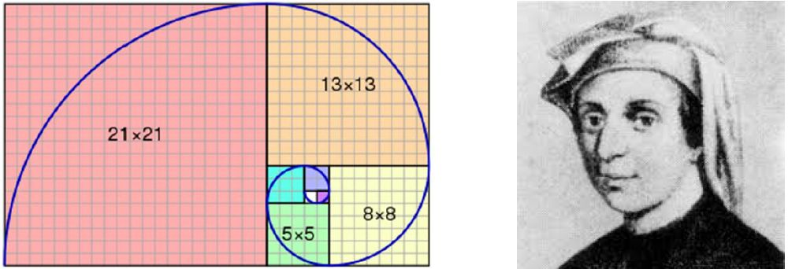

<!-- - - - - - - - - - - - - - - - - - - - - - - - - - - - - - - - - - - - -->
## Assignment C2: Recursive Problem Solving
<!-- - - - - - - - - - - - - - - - - - - - - - - - - - - - - - - - - - - - -->
Recursion is not just a *"function calling itself"*, it is a way of thinking
about a class of problems that can be split into simple "*base cases"* and
remaining *"sub-problems"* that are *"self-similar"*.

A *"sub-problem"* is self-similar when it exactly looks the same as the
original problem, just smaller (e.g. reduced by one element). At some point,
the simple "*base case"* has been reached that yields a primitive solution.

A recursive *solution function* exploiting self-similarity has two phases:

  1. *Reduction:* - slicing the problem (e.g. a list of numbers) into one
        element (e.g. the first number) and a remaining *sub-problem*
        (e.g. the list of remaining numbers).

  1. *Recursion:* -  invoke the same function for the *sub-problem*
        until the *sub-problem* has been reduced to the *base case*.
        Return the solution for the *base case*.

  1. *Construction:* - results of recursive invocations are considered
        as solutions of *sub-problems* and are combined with the element
        that was isolated at the particular level of recursion.

While this approach is elegant from a thinking-about-problems and programming
point of view, it has cost associated for using the
[Callstack](https://en.wikipedia.org/wiki/Call_stack)
using a data structure of an abstract data type
[Stack](https://en.wikipedia.org/wiki/Stack_(abstract_data_type))
for recursions.


### Steps

- [*Step 1:*](#1-create-new-local-branch-c2-recursion) Create new local Branch: `c2-recursion`

- [*Step 2:*](#2-simple-recursion-sum-numbers) Simple recursion: *sum* numbers

- [*Step 3:*](#3-fibonacci-numbers) Fibonacci numbers

- [*Step 4:*](#4-permutation) Permutation

- [*Step 5:*](#5-powerset) Powerset

- [*Step 6:*](#6-find-matching-pairs) Find Matching Pairs

- [*Step 7:*](#7-combinatorial-problem-of-finding-numbers) Combinatorial Problem of Finding Numbers

- [*Step 8:*](#8-hard-problem-of-finding-numbers) Hard Problem of Finding Numbers

- [*Step 9:*](#9-run-tests) Run Tests

- [*Step 10:*](#10-final-test-and-sign-off) Final Test and sign-off

- [*Step 11:*](#11-check-branch-into-your-remote-repository) Check Branch into your remote Repository

<!-- 
Points: [2, 1, 2, 2, 2, 3, 2, +4 extra pts]
 -->

File [*src/recursion/recursion.py*](src/recursion) 
has function stubs defined for each step. Use those functions and complete.
Complete one function after another, run the driver code to validate
and then the corresponding test from
[*tests/recursion/test_recursion.py*](tests/recursion).


<!-- - - - - - - - - - - - - - - - - - - - - - - - - - - - - - - - - - - - -->
&nbsp;
---
### 1. Create new local Branch: `c2-recursion`

Create a new local branch: `c2-recursion` in the project and fill with files
from the remote branch:
[*https://github.com/sgra64/py-fun/tree/c2-recursion*](https://github.com/sgra64/py-fun/tree/c2-recursion).

1. Inspect the remote branch to see what is in it (packages:
    [*src/__init__.py*](src/__init__.py),
    [*src/recursion*](src/recursion) and
    [*tests/recursion*](tests/recursion)).

1. Think about where to branch-off the new local branch `c2-recursion`
    such that it contains project files such as *Makefile*, *setup.py*
    or *pytest.ini*.

1. Fetch the remote branch: `c2-recursion` and merge into the local
    branch `c2-recursion`.


<!-- - - - - - - - - - - - - - - - - - - - - - - - - - - - - - - - - - - - -->
&nbsp;
---
### 2. Simple recursion: *sum()* numbers

Computing the *sum* of numbers is most often performed *iteratively* as a loop
over given numbers and adding them in a result variable.

Solving the problem *recursively* illustrates the concept of self-similarity
and recursive problem solving.

Use the following approach:

  1. *Reduction:* - split the given list of numbers into a first element (first number)
        and a list of remaining numbers (*sub-problem*). Remember the first element.

  1. *Recursion:* - invoke *sum()* for the list of remaining numbers until the base case
        has been reached: *sum( [ ] ) = 0* or *sum( [n] )=n*.

  1. *Construction:* - add the remembered element to the value returned from the
        recursive invocation of *sum()*.

Complete: `sum(_numbers)` using this approach:

```py
def sum(self, _numbers) -> int:
    # your code
    return #...
```

Remove comment from `run_choices` and run the program:

```py
    run_choices = [
        1,      # Challenge 1, Simple recursion: sum numbers
        ...
    ]
```

Output:

```
n1.numbers: [9, 4, 8, 10, 2, 4, 8, 3, 14, 4, 8]
sum(n1.numbers): 74
```

Answer questions:

  1. How many time is the *"first element"* stored?
    How much memory is used for applying the function to a list of *n* numbers?

  1. What is the run-time estimate for *sum()* given a list of *n* numbers?

  1. How many *stack-frames* are used for a list of *n* numbers?


<!-- - - - - - - - - - - - - - - - - - - - - - - - - - - - - - - - - - - - -->
&nbsp;
---
### 3. *Fibonacci* numbers

[*Fibonacci numbers*](https://en.wikipedia.org/wiki/Fibonacci_number) were first
described in Indian mathematics as early as 200 BC in works by *Pingala* on
enumerating possible patterns of Sanskrit poetry formed from syllables of two lengths.

Italian mathematician *Leonardo of Pisa*, later known as
[*Fibonacci*](https://en.wikipedia.org/wiki/Fibonacci),
introduced the sequence to Western European mathematics in his 1202 book
[*Liber Abaci*](https://en.wikipedia.org/wiki/Liber_Abaci).

Numbers of the *Fibonacci sequence* are defined as: *fib(0): 0*, *fib(1): 1*, *...*
and each following number is the sum of the two preceding numbers.

Fibonacci numbers are widely found in *nature*, *science*, *social behaviors* of
populations and *arts*, e.g. they form the basis of the
[*Golden Ratio*](https://www.adobe.com/creativecloud/design/discover/golden-ratio.html),
which is widely used in *painting* and *photography*, see also this
[1:32min](https://www.youtube.com/watch?v=v6PTrc0z4w4) video.



&nbsp;

Complete functions `fib(n)` and `fib_gen(n)`.

```py
def fib(self, _n) -> int:
    # return value of n-th Fibonacci number
    return #...

def fib_gen(self, _n):
    # return a generator object that yields two lists, one with n and the
    # other with corresponding fib(n)
    yield #...
```

Remove comment from `run_choices` and run the program:

```py
    run_choices = [
        1,      # Challenge 1, Simple recursion: sum numbers
        2,      # Challenge 2, Fibonacci numbers
        ...
    ]
```

Output:

```
n:      [0, 1, 2, 3, 4, 5, 6, 7, 8, 9, 10, 11, 12, 13, 14, 15, 16, 17, 18, 19, 20]
fib(n): [0, 1, 1, 2, 3, 5, 8, 13, 21, 34, 55, 89, 144, 233, 377, 610, 987, 1597, 2584, 4181, 6765]
```

Answer questions:

  1. Explain the concept of a generator in Python.

  1. Why can't `fib(60)` or `fib(90)` be computed recursively?

  1. What is the more limiting constraint: memory use or needed run time?
        ```py
        n = 30
        print(f'fib({n}): {n1.fib(n)}')
        n = 60
        print(f'fib({n}): {n1.fib(n)}')     # ??
        n = 90
        print(f'fib({n}): {n1.fib(n)}')     # ??
        ```

Understand the problem and use a technique called
[memoization](https://stackoverflow.com/questions/7875380/recursive-fibonacci-memoization)
to make the solution work for *n=60* and *n=90* - still recursively (!).

Remove comments `#21` and `#22` from `run_choices` and run the program:

Output:

```
fib(30): 832040
fib(60): 1548008755920
fib(90): 2880067194370816120
```


<!-- - - - - - - - - - - - - - - - - - - - - - - - - - - - - - - - - - - - -->
&nbsp;
---
### 4. Permutation

[Permutation](https://en.wikipedia.org/wiki/Permutation) is a list of all
arrangements of elements.

For example:
```py
perm([1, 2, 3]) -> [[1, 2, 3], [1, 3, 2], [2, 1, 3], [2, 3, 1], [3, 1, 2], [3, 2, 1]]

perm([]) -> [[]]
perm([1]) -> [[1]]
perm([1, 2]) -> [[1, 2], [2, 1]]
perm([1, 2, 3]) -> [[1, 2, 3], [1, 3, 2], [2, 1, 3], [2, 3, 1], [3, 1, 2], [3, 2, 1]]
perm([1, 2, 3, 4]) -> [[1, 2, 3, 4], [1, 2, 4, 3], ... [4, 3, 1, 2], [4, 3, 2, 1]]
```
Find a pattern how numbers are arranged for `perm([1, 2])` and `perm([1, 2, 3])`
and adapt it for `perm([1, 2, 3, 4])` to understand the algorithm.

Writing non-recursive code for that algorithm can be difficult, but it fits
well with the recursive sub-problen approach, which is elegant with the
four steps:
1. Return solutions for trivial cases: `[]`, `[1]`, `[1, 2]`.
1. Split the problem by removing the first number `n1` from the list leaving `r` as
    remaining list (sub-problem).
1. Invoke `perm(r)` recursively on the remaining list.
1. Combine the result returned from `perm(r)` by adding `n1` to each element.

```py
def perm(self, _numbers) -> list:
    res=[]  # collect result
    # code...
    # 1. Return solutions for trivial cases: `[]`, `[1]`, `[1, 2]`.
    # 2. Split the problem by removing the first number `n1` from the list
    #    leaving `r` as remaining list (sub-problem).
    # 3. Invoke `perm(r)` recursively on the remaining list.
    # 4. Combine the result by adding `n1` to each returned element from `perm(r)`.
    #
    return res

lst = [1, 2, 3]
perm = n1.perm(lst)
print(f'perm({lst}) -> {perm}')

lst = [1, 2, 3, 4]
perm = n1.perm(lst)
print(f'perm({lst}) -> {perm}')
```

Remove comment `#3` from `run_choices` and run the program:

Output:

```
perm([1, 2, 3]) -> [[1, 2, 3], [1, 3, 2], [2, 1, 3], [2, 3, 1], [3, 1, 2], [3, 2, 1]]
perm([1, 2, 3, 4]) -> [[1, 2, 3, 4], [1, 2, 4, 3], ... [4, 3, 1, 2], [4, 3, 2, 1]]
```

Answer questions:

  - With a rising length of the input list, how does the number of permutations grow?


<!-- - - - - - - - - - - - - - - - - - - - - - - - - - - - - - - - - - - - -->
&nbsp;
---
### 5. Powerset

[Powerset](https://en.wikipedia.org/wiki/Powerset) is a list of all
subsets of elements including the empty set.

For example:
```py
pset([1, 2, 3]) -> [[], [1], [2], [1, 2], [3], [1, 3], [2, 3], [1, 2, 3]]
```
Undertstand the pattern and complete function `pset()`.

```py
def pset(self, _numbers) -> list:
    res=[]  # collect result
    # code...
    # 1. Return solutions for trivial cases: `[]`, `[1]`, `[1, 2]`.
    # 2. Split the problem by removing the first number `n1` from the list
    #    leaving `r` as remaining list (sub-problem).
    # 3. Invoke `pset(r)` recursively on the remaining list.
    # 4. Combine the result with the first element.
    #
    return res

lst = [1, 2, 3]
pset = n1.pset(lst)
print(f'pset({lst}) -> {pset}')
```

Remove comment `#4` from `run_choices` and run the program:

Output:

```py
pset([1, 2, 3]) -> [[], [1], [2], [1, 2], [3], [1, 3], [2, 3], [1, 2, 3]]
```

Answer questions:

  - With a rising length of the input list, how does the size of the Powerset grow?


<!-- - - - - - - - - - - - - - - - - - - - - - - - - - - - - - - - - - - - -->
&nbsp;
---
### 6. Find Matching Pairs

Write three functions to `find` elements in a list.

The first function to `find` elements that match a boolean `match_func`.

A second function `find_adjacent` that finds all indexes of adjacent pairs
of numbers.

The third function `find_pairs` that finds all pairs of numbers (not necessarily
adjacent) with the sum equal to `n`. For example, `n=12` can be combined from
the input list with pairs: `[3, 9], [4, 8], [2, 10]`.

```py
def find(self, _numbers, match_func) -> list:
    res = []    # code...
    return res


def find_adjacent(self, pair, _numbers) -> list:
    res = []    # code...
    return res


def find_pairs(self, n, _numbers) -> list:
    res = []    # code...
    return res


lst = [9, 4, 8, 10, 2, 4, 8, 3, 14, 4, 8]   # input list
#
div3 = n1.find(lst, match_func=lambda n : n % 3 == 0)
print(f'find numbers divisible by 3: {div3}')
#
p = [4, 8]  # find all indexes of adjacent numbers [4, 8]
adj = n1.find_adjacent(p, lst)
print(f'find_adjacent({p}, list): {adj}')
#
n = 12  # find all pairs from the input list that add to n
pairs = n1.find_pairs(n, lst)
print(f'find_pairs({n}, list) -> {pairs}')
```

Remove comments `#5`, `#51` and  `#52` from `run_choices` and run the program:

Output:

```
find numbers divisible by 3: [9, 3]

find_adjacent([4, 8], list): [1, 5, 9]

find_pairs(12, list) -> [[3, 9], [4, 8], [2, 10]]
```

Answer questions:

  - With a rising length of the input list, how many steps are needed to
    complete each function in the best and worst case and on average?

    | function         | answers     |
    | ---------------- | ----------- |
    | `find`           | best case: ______, worst case: ______, average: ______ steps.  |
    | `find_adjacent`  | best case: ______, worst case: ______, average: ______ steps.  |
    | `find_pairs`       | best case: ______, worst case: ______, average: ______ steps.  |


<!-- - - - - - - - - - - - - - - - - - - - - - - - - - - - - - - - - - - - -->
&nbsp;
---
### 7. Combinatorial Problem of Finding Numbers

`find_all_sums` is a function that returns any combination of numbers from the
input list that add to `n`. For example, `n=14` can be combined from an
input list: `[8, 10, 2, 14, 4]` by combinations: `[4, 8, 2], [4, 10], [14]`.

A first approach to the problem is to understand the nature of possible
combinations from the input list. If all those combinations could be
generated, each could be tested whether their elements add to `n` and if,
collect them for the final result.

The order of numbers in solutions is not relevant (summation is commutative).
Duplicate solutions with same numbers, but in different order need be to removed.

```py
def find_all_sums(self, n, _numbers) -> list:
    res = []    # code...
    return res


lst = [8, 10, 2, 14, 4]     # input list
n = 14
all = n1.find_all_sums(n, lst)
print(f'find_all_sums({n}, lst) -> {all}')
```

Output:
```py
find_all_sums(14, lst) -> [[4, 8, 2], [4, 10], [14]]
```

Test your solution with a larger input set:
```py
lst = [     # input list
    260, 720, 225, 179, 101, 767, 167, 200, 157, 289,
    318, 303, 153, 290, 201, 594, 457, 607, 592, 246,
]
n = 469
all = n1.find_all_sums(n, lst)
print(f'find_all_sums({n}, lst) -> {all}')
```

Remove comments `#6`, and  `#61` from `run_choices` and run the program:

Output:

```
find_all_sums(469, lst) -> [[179, 290], [101, 167, 201]]
```

Answer questions:

  - With a rising length of the input list, how does the number of possible
    solutuions rise that must be tested?


<!-- - - - - - - - - - - - - - - - - - - - - - - - - - - - - - - - - - - - -->
&nbsp;
---
### 8. Hard Problem of Finding Numbers

Larger data sets can no longer be solved *"brute force"* by exploring all possible
2^n combinations.

Find a solution using a recursive approach exploring a decision tree or
with tabulation.

```py
lst = [     # input list
    260, 720, 225, 179, 101, 767, 167, 200, 157, 289,
    318, 303, 153, 290, 201, 594, 457, 607, 592, 246,
    132, 135, 584, 432, 591, 204, 417, 405, 362, 658,
    136, 751, 583, 536, 293, 493, 431, 780, 563, 703,
    400, 618, 397, 320, 513, 708, 319, 317, 685, 347,
    758, 439, 145, 378, 158, 384, 551, 110, 408, 648,
    847, 498,  50,  19,     # 64 numbers
]
n = 469
all = n1.find_all_sums(n, lst)
for i, s in enumerate(all):
    print(f' - {i+1:2}: sum({sum(s)}) -> {s}')
```

Sort output by lenght of solution (use length as primary and numeric value
of first element as secondary criteria).

Remove comment `#7` if you tackled the challenge and run the program:

Output:

```
  1: sum(469) -> [290, 179]
  2: sum(469) -> [19, 157, 293]
  3: sum(469) -> [19, 246, 204]
  4: sum(469) -> [19, 318, 132]
  5: sum(469) -> [19, 400, 50]
  6: sum(469) -> [50, 101, 318]
  7: sum(469) -> [110, 201, 158]
  8: sum(469) -> [136, 201, 132]
  9: sum(469) -> [145, 167, 157]
 10: sum(469) -> [158, 179, 132]
 11: sum(469) -> [201, 101, 167]
 12: sum(469) -> [19, 101, 204, 145]
 13: sum(469) -> [19, 157, 135, 158]
 14: sum(469) -> [19, 179, 135, 136]
 15: sum(469) -> [19, 204, 136, 110]
 16: sum(469) -> [19, 290, 110, 50]
 17: sum(469) -> [19, 101, 167, 132, 50]
 18: sum(469) -> [19, 132, 158, 110, 50]
```


<!-- - - - - - - - - - - - - - - - - - - - - - - - - - - - - - - - - - - - -->

&nbsp;
---
### 9. Run Tests

Once an expression seems to be working, run the correspondig test in the IDE.
Fix your expression in the IDE when the test is failing. When working in the
IDE, run tests selectively in the terminal:

```sh
# run the test for a) test_a_sum_numbers
pytest -v \
    tests/recursion/test_recursion.py::TestRecursion::test_a_sum_numbers

# when test a) runs, add test b) test_b_fib
pytest -v \
    tests/recursion/test_recursion.py::TestRecursion::test_a_sum_numbers \
    tests/recursion/test_recursion.py::TestRecursion::test_b_fib

# add tests incrementally to the full set
pytest -v \
    tests/recursion/test_recursion.py::TestRecursion::test_a_sum_numbers \
    tests/recursion/test_recursion.py::TestRecursion::test_b_fib \
    tests/recursion/test_recursion.py::TestRecursion::test_b_fib_memo \
    tests/recursion/test_recursion.py::TestRecursion::test_b_fib_gen \
    tests/recursion/test_recursion.py::TestRecursion::test_c_perm \
    tests/recursion/test_recursion.py::TestRecursion::test_d_pset \
    tests/recursion/test_recursion.py::TestRecursion::test_e_find_matches \
    tests/recursion/test_recursion.py::TestRecursion::test_f_find_adjacent \
    tests/recursion/test_recursion.py::TestRecursion::test_g_find_pairs \
    tests/recursion/test_recursion.py::TestRecursion::test_h_find_all_sums \
    tests/recursion/test_recursion.py::TestRecursion::test_h_find_all_sums_XL \
    tests/recursion/test_recursion.py::TestRecursion::test_h_find_all_sums_XXL

# run all tests at the end
make tests
```


<!-- - - - - - - - - - - - - - - - - - - - - - - - - - - - - - - - - - - - -->

&nbsp;
---
### 10. Final Test and sign-off

Run all tests:

```sh
# run all tests (using the pytest framework)
make tests

# run tests using the pytest framework
python -m pytest -v
pytest -v

# run tests using the unit-test framework
python -m unittest
```
<!-- 
For sign-off, change into `C_expressions` directory and copy commands into a terminal:

```sh
# Fetch test file from Gitlab and run tests for sign-off.
# The sed-command removes comments from test cases.

test_url=https://gitlab.bht-berlin.de/sgraupner/ds_cs4bd_2324/-/raw/main/C_expressions/test_expressions.py

curl $test_url | \
   sed -e 's/^#.*Test_case_/Test_case_/' | \
   python
```
-->

Result (pytest -v output):

```
pytest -v
=============================================================================== test session starts
platform win32 -- Python 3.12.0, pytest-8.4.2, pluggy-1.6.0 -- C:\Users\svgr2\AppData\Local\Programs\Python\Python312\python.exe
cachedir: .pytest_cache
rootdir: C:\Sven1\svgr2\workspaces\cs4bd\py-fun
configfile: pytest.ini
testpaths: tests/recursion
collected 12 items

tests/recursion/test_recursion.py::TestRecursion::test_a_sum_numbers        PASSED [  8%]
tests/recursion/test_recursion.py::TestRecursion::test_b_fib                PASSED [ 16%]
tests/recursion/test_recursion.py::TestRecursion::test_b_fib_gen            PASSED [ 25%]
tests/recursion/test_recursion.py::TestRecursion::test_b_fib_memo           PASSED [ 33%]
tests/recursion/test_recursion.py::TestRecursion::test_c_perm               PASSED [ 41%]
tests/recursion/test_recursion.py::TestRecursion::test_d_pset               PASSED [ 50%]
tests/recursion/test_recursion.py::TestRecursion::test_e_find_matches       PASSED [ 58%]
tests/recursion/test_recursion.py::TestRecursion::test_f_find_adjacent      PASSED [ 66%]
tests/recursion/test_recursion.py::TestRecursion::test_g_find_pairs         PASSED [ 75%]
tests/recursion/test_recursion.py::TestRecursion::test_h_find_all_sums      PASSED [ 83%]
tests/recursion/test_recursion.py::TestRecursion::test_h_find_all_sums_XL   PASSED [ 91%]
tests/recursion/test_recursion.py::TestRecursion::test_h_find_all_sums_XXL  PASSED [100%]
=============================================================================== 12 passed in 0.51s
```


<!-- - - - - - - - - - - - - - - - - - - - - - - - - - - - - - - - - - - - -->

&nbsp;
---
### 11. Check Branch into your remote Repository

Check branch `c2-recursion` into your remote repository.
